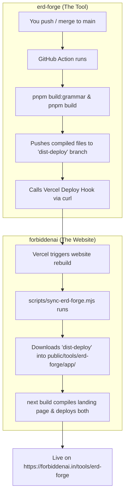
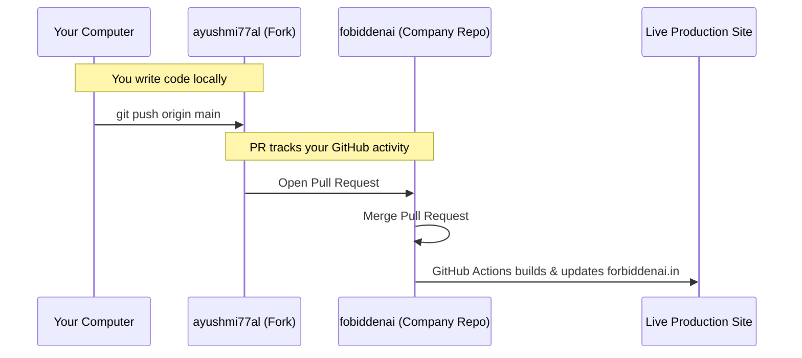

# How ERD Forge & Forbidden AI Work Together — Simple Guide

This guide explains the entire architecture, how the two repositories talk to each other, and your day-to-day workflow for maintaining them in simple, clear terms.

---

## 1. The Big Picture: The "Showroom & Tool" Model

Instead of cramming two very different projects into one giant codebase, we separated them into two distinct roles:

```
┌────────────────────────────────────────────────────────┐
│                   FORBIDDENAI.IN                       │
├───────────────────────────┬────────────────────────────┤
│   The Showroom            │   The Tool                 │
│   /tools/erd-forge        │   /tools/erd-forge/app/    │
├───────────────────────────┼────────────────────────────┤
│ • Next.js (SSR)           │ • Vite SPA (Static HTML/JS)│
│ • Google & AI search SEO  │ • Full-screen canvas       │
│ • Main site header/footer │ • Runs SQLite inside browser│
│ • Vercel Analytics active │ • Isolated COEP security   │
└───────────────────────────┴────────────────────────────┘
```

### Why this 2-URL structure was chosen:
1. **Google & AI Engines (Perplexity, ChatGPT, Gemini)**: Crawlers need server-rendered HTML with metadata, FAQs, and schema data to index and recommend the tool. They cannot easily index a blank canvas SPA. That is what `/tools/erd-forge` does.
2. **The App (`/tools/erd-forge/app/`)**: The actual database designer runs an in-browser database (`wa-sqlite`) that requires strict browser security headers (`Cross-Origin-Embedder-Policy`). If we put those headers on the whole website, Vercel Analytics would break. By isolating the app into `/app/`, the main site stays fast and analytics-safe, while the tool gets full native browser speed.

---

## 2. How the Repositories Connect

You have two separate repositories on GitHub:
- **`erd-forge`**: Built with Vite, React 19, TypeScript, and `pnpm`.
- **`forbiddenai`**: Built with Next.js 16, Tailwind v4, and `npm`.

They never share package managers or code files directly. Instead, they communicate via an **Automated Conveyor Belt**:



### The Delivery Branch (`dist-deploy`)
Think of `dist-deploy` as an automated delivery box:
1. Every time `erd-forge` merges to `main`, GitHub Actions packages the finished HTML/JS/CSS into `dist-deploy`.
2. It sends an automated ping (Deploy Hook) to Vercel saying: *"A new version of ERD Forge is ready!"*
3. Vercel starts building `forbiddenai`, downloads that delivery box into `public/tools/erd-forge/app/`, and deploys everything together.

**You never have to manually copy files between folders.**

---

## 3. How Contribution & Forks Work

Because you contribute using your personal GitHub account (`ayushmi77al`) to the company repositories (`fobiddenai`), your workflow looks like this:



### Why this is great:
- **Public Portfolio**: Every PR and merge appears on your personal GitHub contribution graph.
- **Safety**: The main company website repo remains clean, controlled, and deployable.
- **Independence**: `erd-forge` doesn't know anything about Next.js, and `forbiddenai` doesn't know anything about `pnpm` or `peggy` grammar parsers.

---

## 4. Your Day-to-Day Maintenance Cheat Sheet

### Scenario A: You want to update the ERD Forge tool
*(Add a feature, fix a canvas bug, improve SQL parsing)*

1. Open your terminal in `c:\Users\ayush.mittal\Projects\erd-forge`.
2. Write and test your code locally (`pnpm dev`).
3. Commit and push to your fork:
   ```powershell
   git add .
   git commit -m "feat: add table color customization"
   git push origin main
   ```
4. On GitHub, click **Contribute → Open pull request** into `fobiddenai/erd-forge:main`.
5. Merge the PR.
6. **Done!** GitHub Actions compiles the bundle, updates `dist-deploy`, and automatically triggers Vercel to update `forbiddenai.in`.

---

### Scenario B: You want to update the Landing Page or Site
*(Change copy, add testimonials, update pricing/features list, tweak styles)*

1. Open your terminal in `c:\Users\ayush.mittal\Projects\forbiddenai`.
2. Edit [page.tsx](file:///c:/Users/ayush.mittal/Projects/forbiddenai/app/tools/erd-forge/page.tsx) or site components.
3. Test locally with `npm run dev`.
4. Commit and push:
   ```powershell
   git add .
   git commit -m "docs: update ERD Forge feature list"
   git push origin main
   ```
5. Merge the PR into `fobiddenai/forbiddenai:main`.
6. Vercel automatically deploys the updated landing page.

---

## 5. Summary Table

| What | Where it lives | How it is built | How it deploys |
|---|---|---|---|
| **Landing Page** | `forbiddenai/app/tools/erd-forge/` | Next.js Server Components | Vercel on push to `forbiddenai:main` |
| **Tool App** | `erd-forge/apps/web/` | Vite + React + wa-sqlite | GitHub Action compiles to `dist-deploy` → Vercel syncs it |
| **Bridge** | `forbiddenai/scripts/sync-erd-forge.mjs` | Node.js script | Runs automatically during `npm run build` |
| **AI Index** | `forbiddenai/public/llms.txt` | Markdown | Static file served at root |
